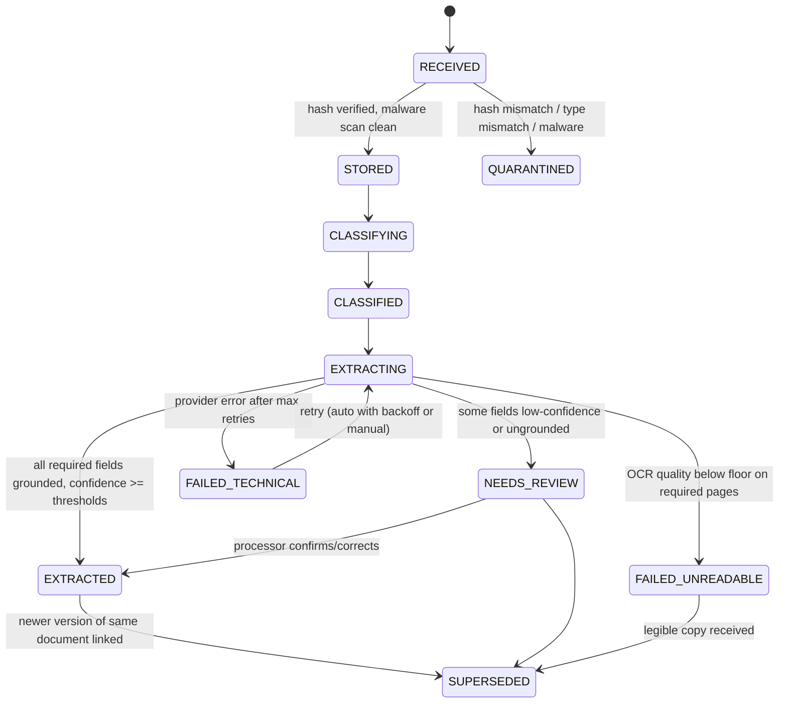

# 03 — Workflows, states, roles and UX

Status: **PROPOSED** throughout. No Superclaims screens are public (01 §3). Wireframes are our own designs and are not evidence about competitor behaviour.

## 1. Roles

| Role | Typical background | Main job in AW | Can record a decision? |
|---|---|---|---|
| PROCESSOR | Pharma, nursing or life-science graduate; TPA ops (cf. E-LI-07) | Non-medical scrutiny: documents, identity, bill lines, deductions, queries | Yes, within approval limit |
| MEDICAL_OFFICER | MBBS/BAMS/BHMS | Clinical findings, waiting-period and exclusion questions, medical justification | Yes, for medical findings; payable within limit |
| SUPERVISOR | Senior processor/MO | Allocation, second approval, reopened claims, unanswered queries | Yes; second approver |
| AUDITOR | Claims audit | Read-only sampling, comments, audit export | No |
| FWA_ANALYST | Investigation team | Triage anomaly flags; request investigation hold | No (can place a hold) |
| CONFIG_ADMIN | Claims-manual owner | Author policy configs, NME lists, tariffs; replay | No |
| TENANT_ADMIN | IT/admin | Users, roles, approval limits, integrations | No |
| READ_ONLY | Insurer liaison, QA | View | No |

## 2. State models

Four separate state machines. They are kept separate because each one changes for different reasons and different roles own the changes.

### 2.1 Document processing state (`doc_status`)



| Transition | Actor | Side effects |
|---|---|---|
| → STORED | SYSTEM | `DOCUMENT_RECEIVED` audit event; page split; jobs queued (idempotency key = document_id + job kind + pipeline version) |
| → QUARANTINED | SYSTEM | Security alert; the processor sees "file could not be accepted" with the reason code. Content is never displayed |
| → NEEDS_REVIEW | SYSTEM | Claim-level review task; the dependent rule scopes are blocked until the fields are confirmed |
| → FAILED_UNREADABLE | SYSTEM | `DOCUMENT_INCOMPLETE` finding + draft query "legible copy" to the hospital |
| → SUPERSEDED | PROCESSOR or SYSTEM (explicit `supersedes_document_id`) | Current evaluation → `STALE` |

### 2.2 Claim workflow state (`claim_status`)

```mermaid
stateDiagram-v2
  [*] --> INTAKE
  INTAKE --> DOCS_INCOMPLETE: checklist gaps after grace window
  INTAKE --> PROCESSING: documents present
  DOCS_INCOMPLETE --> PROCESSING: missing documents arrive
  PROCESSING --> READY_FOR_REVIEW: evaluation COMPUTED or BLOCKED
  PROCESSING --> PROCESSING: evaluation FAILED (auto-retry; then supervisor queue / manual entry)
  READY_FOR_REVIEW --> IN_REVIEW: processor opens claim (assignment)
  IN_REVIEW --> MEDICAL_REVIEW: open MO finding / escalate
  MEDICAL_REVIEW --> IN_REVIEW: MO resolves
  IN_REVIEW --> QUERY_RAISED: query approved and released
  QUERY_RAISED --> AWAITING_RESPONSE: delivered to addressee
  AWAITING_RESPONSE --> PROCESSING: response documents arrive
  IN_REVIEW --> PENDING_APPROVAL: processor submits; second approval required
  PENDING_APPROVAL --> IN_REVIEW: returned for rework
  IN_REVIEW --> ESCALATED_CRC: repudiation proposed
  ESCALATED_CRC --> FINALISED: CRC approves repudiation (reference recorded)
  ESCALATED_CRC --> IN_REVIEW: CRC declines repudiation (reference recorded)
  PENDING_APPROVAL --> FINALISED: approver signs
  IN_REVIEW --> FINALISED: within own limit
  IN_REVIEW --> FINALISED: CLOSED_DUPLICATE (duplicate_of_claim_id required)
  FINALISED --> EXPORTED: TMS acknowledges
  FINALISED --> REOPENED: late evidence / grievance (supervisor)
  EXPORTED --> REOPENED
  REOPENED --> PROCESSING
  INTAKE --> WITHDRAWN
  IN_REVIEW --> WITHDRAWN: claimant/insurer withdrawal recorded
```



Guards:

- No transition to `FINALISED` without a decision row against a non-stale evaluation.
- `ESCALATED_CRC → FINALISED` requires `crc_reference` and `communicated_by = INSURER`. For a TPA tenant this records the insurer's outcome; AW sends no repudiation letter (workflow config `RECORD_INSURER_OUTCOME_ONLY`, E-REG-04).
- `ESCALATED_CRC → IN_REVIEW` when the CRC declines: a SUPERVISOR records reviewer action `RECORD_CRC_DECLINED` with the CRC reference and reasons (audit event `CRC_OUTCOME_RECORDED`), and the claim returns for a payable decision.
- A `FAILED` evaluation (engine or configuration error, e.g. a rule with no clause reference) never produces a recommendation. The claim stays in `PROCESSING` with a visible reason. After automatic retries it goes to the supervisor queue; a configuration error goes to CONFIG_ADMIN.
- `CLOSED_DUPLICATE` requires `duplicate_of_claim_id`. It is a decision, so it needs a current evaluation like any other.
- An investigation hold (`claim.investigation_hold`, set by FWA_ANALYST or SUPERVISOR) is a flag, not a state. It disables decision actions until released.
- No automatic transition out of `AWAITING_RESPONSE` to any closed state. Non-response goes to a supervisor queue on the customer's reminder schedule (E-REG-03).
- Every transition increments `row_version`. Clients must send `If-Match`.

### 2.3 Evaluation / recommendation state (`evaluation_status`)

`RUNNING → COMPUTED | BLOCKED | FAILED`. Then `COMPUTED | BLOCKED → STALE` on any of: a new document, a supersession, a reviewer correction of a rule input, or a retroactive configuration change. Then `STALE → SUPERSEDED` when the next evaluation completes.

- Only the newest `COMPUTED`/`BLOCKED` evaluation is "current".
- A re-run with an identical input hash and engine version is deduplicated (DB unique constraint). It returns the existing evaluation. The input hash covers the claim inputs **and** every config version (policy config, NME list, tariff, checklist, rule versions), so a new tariff or NME list always produces a new evaluation (TC-CFG-04).
- Reviewer overrides are re-applied to the new evaluation only when the line's fingerprint is unchanged (TC-REV-03).

### 2.4 Final disposition (`disposition_type`)

`APPROVED_FULL`, `APPROVED_PARTIAL`, `REPUDIATED_WITH_CRC_APPROVAL`, `WITHDRAWN`, `CLOSED_DUPLICATE`. A query is not a disposition: it is a workflow step (claim state `QUERY_RAISED`) recorded as a query letter and a reviewer action, so raising a query never uses up the evaluation's one decision. Decisions are append-only. A reopened claim gets a new decision linked to a new evaluation. The worksheet shows the delta against the previous decision.

### 2.5 After new evidence arrives

1. Document received and stored (`DOCUMENT_RECEIVED` comes first in the audit trail), then the current evaluation is marked `STALE`. Its banner changes to "Recommendation out of date — new document received 14:52". Decision buttons are disabled.
2. Extraction runs on the new document only. Unchanged documents keep their facts.
3. Fact resolution re-runs. Previously resolved conflicts stay resolved unless the new document adds a disagreeing observation. In that case the conflict re-opens with the reviewer's earlier resolution shown.
4. A new evaluation runs. Findings carry over with continuity: same kind, same subject → same finding with `last_evaluation_id` updated. A finding that no longer fires → status `SUPERSEDED`, still visible in history.
5. The reviewer sees a diff (S-02 "What changed") of facts, adjustments and payable versus the previous evaluation.

## 3. Reviewer journey: IPD reimbursement (target ≈ 15 min human time; baseline to be measured)

1. **Queue (S-01).** Processor opens the next claim ordered by TAT due time. Blocked claims with ready query drafts are grouped separately.
2. **Orientation (S-02 header, ~30 s).** Patient, policy, hospital, dates, clock, recommendation chip, billed vs recommended payable, count of open findings by severity.
3. **Blocks first (~2 min).** Each blocking finding is pinned at the top with its evidence side by side. Resolve it (choose the value and cite evidence) or keep it and add it to the query.
4. **Bill review (~5 min).** A table of lines with category, billed, deductions (stacked by rule) and payable. Filter "lines with deductions". Each deduction row opens its evidence on the left and its rule and clause on the right. Accept all (keyboard `A` on a group) or override with a reason.
5. **Clinical questions (MO, ~5 min when present).** Cited summary; questions; MO records an answer with a reason. The claim returns to the processor.
6. **Anomalies.** Flags are listed. The processor can only acknowledge them or forward to FWA. They cannot dismiss a HIGH flag without a supervisor.
7. **Query or decide (~1–2 min).** Query composer (S-06) pre-filled from findings; or decision panel (S-07) with explanation preview, approval limit and second-approver routing.
8. **Audit (S-08).** Available at any time. Nothing to do routinely.

## 4. Permission matrix (P = permitted; L = within approval limit; 2 = needs a second approver when a workflow-config rule fires, see 02 CAP-17)

| Action | PROCESSOR | MEDICAL_OFFICER | SUPERVISOR | AUDITOR | FWA_ANALYST | CONFIG_ADMIN | TENANT_ADMIN | READ_ONLY |
|---|---|---|---|---|---|---|---|---|
| View claim & evidence | P | P | P | P | P | — | — | P (masked identifiers) |
| Upload / supersede document | P | P | P | — | — | — | — | — |
| Correct fact / resolve conflict | P | P | P | — | — | — | — | — |
| Reclassify line; override/add/remove adjustment | P (reason + comment) | P | P | — | — | — | — | — |
| Resolve clinical finding | — | P | P (non-clinical only) | — | — | — | — | — |
| Dismiss HIGH anomaly | — | — | P | — | P | — | — | — |
| Place investigation hold | — | — | P | — | P | — | — | — |
| Approve query letter | P (if configured) | P | P | — | — | — | — | — |
| Record decision APPROVED_* | L / 2 | L / 2 | L | — | — | — | — | — |
| Record REPUDIATED_WITH_CRC_APPROVAL (insurer tenant) | — | — | P (with CRC ref) | — | — | — | — | — |
| Reopen claim | — | — | P | — | — | — | — | — |
| Author config | — | — | — | — | — | P | — | — |
| Publish config (cannot be the author) | — | — | — | — | — | P | — | — |
| Manage users/limits/integrations | — | — | — | — | — | — | P | — |
| Record insurer CRC outcome (TPA tenant) | — | — | P (with CRC ref) | — | — | — | — | — |
| Record CLOSED_DUPLICATE | — | — | P (with duplicate claim ref) | — | — | — | — | — |

## 5. How values are shown

The same field can carry four different values. The UI never lets them blur.

| Value kind | Visual treatment (colour is never the only cue) | Example |
|---|---|---|
| **Extracted** (machine) | Regular text with a small "doc" glyph and a page chip `FB p2`. Confidence shown as a 3-step bar only when below threshold | `02-09-2026  ▸FB p1` |
| **Reviewer-entered/selected** | Text with a person glyph and initials, plus the original struck through on hover | `02-09-2026 👤PR04 (was 03-09-2026)` |
| **Proposed by engine** (recommendation) | Dashed outline box, label "Proposed" | `Proposed payable ₹85,570 if MO clears` (trace 3b, awaiting the medical officer) |
| **Final decision** | Solid filled badge with lock glyph, decided by / at | `Approved ₹85,000 🔒 SUP-02 09 Jul 11:29` (trace 2, DEC-0002) |

Amounts use Indian digit grouping (₹1,72,455.75) in tabular figures, right-aligned. Negative (rounding) adjustments show as "+₹0.50 rounding". Dates are shown as `02 Sep 2026` (unambiguous) and stored as ISO.

## 6. Screen inventory and navigation

```
S-01 Work queue ──► S-02 Claim workspace ─┬─ S-03 Document & evidence viewer (left pane)
                                           ├─ S-04 Bill & deductions (centre tab)
                                           ├─ S-05 Findings: blocks, clinical, anomalies (centre tab)
                                           ├─ S-06 Query composer (drawer)
                                           ├─ S-07 Decision & approval (drawer)
                                           └─ S-08 Audit timeline (tab)
S-09 Configuration: policy configs · NME lists · tariffs · checklists · replay
S-10 Operations metrics
S-11 Administration: users, roles, limits, integrations
```

| Screen | Purpose | Key fields | Actions | Permissions | Validation | Loading / empty / error | Acceptance |
|---|---|---|---|---|---|---|---|
| S-01 Work queue | Pick the right next claim | Claim ref, workflow, patient (masked), hospital, recommendation chip, open blocks, TAT due (relative + absolute), assignee | Filter, sort by due, claim next, bulk assign (SUP) | All reviewer roles | — | Skeleton rows; empty "No claims in this view" with filter reset; error banner with retry and correlation ID | TC-UX-04: next-claim ≤ 1 click; due-time sort default |
| S-02 Claim workspace | Single place to review | Header (patient, policy, SI available, hospital, dates, clock), recommendation summary, tabs | Switch tabs, open drawers, keyboard nav | Reviewer roles; AUDITOR read-only | ETag on every write; 412 → "Claim changed — reload" | Per-pane skeletons; STALE banner disables decisions | TC-UX-01, TC-DEC-02 |
| S-03 Evidence viewer | See the exact page region behind any value | Page image with highlight box, quote, document type, page nav, OCR text toggle | Jump from any chip; rotate; mark page unreadable; link supersession | Reviewer roles | — | Image lazy load; OCR-unavailable notice | TC-UX-02: any finding/deduction → highlighted evidence in 1 click, ≤ 300 ms after load |
| S-04 Bill & deductions | Review lines and money | Line no., description, category (source glyph), context, billed, deductions (stacked chips by rule), payable; totals; claim-level ladder (admissible → co-pay → SI cap → rounding → payable) | Reclassify, override/add/remove adjustment (reason + comment), accept group, filter | PROCESSOR, MO, SUP | Override amount ≤ remaining; comment required; can't override `ROUNDING` | Lines skeleton; "Line rules blocked: itemised bill missing" empty state | TC-REV-01; ladder reconciles to the paisa |
| S-05 Findings | Resolve blocks and questions | Kind, severity, blocking scopes, evidence, route, uncertainty note, status | Resolve (with evidence), dismiss (role-gated), add to query, escalate | Role-gated per §4 | Dismiss requires comment; HIGH anomaly needs SUP/FWA | Empty "No open findings" | TC-CLN-02 wording checks; TC-ANO-01 |
| S-06 Query composer | Ask for what's missing | Addressee (default hospital), items (text, requested document type, linked findings), due date | Edit, reorder, preview letter, submit for approval / approve | Per config | ≥ 1 item; text ≤ 1,000 chars; addressee required | Draft autosave (server-side) | TC-QRY-01 |
| S-07 Decision & approval | Record the human disposition | Recommendation, proposed payable, decision type, approved amount, deviation, which second-approval rule fired, explanation preview, approver chain, CRC ref field (for repudiation) | Approve, send for second approval, refer to CRC, record insurer CRC outcome (TPA tenant), return | Limits per §4; second-approval rules per workflow config | Amount ≤ billed; deviation reason when ≠ proposed; CRC ref format; approver ≠ requester | Disabled when STALE, blocks open, or an investigation hold is set | TC-DEC-01..03 |
| S-08 Audit timeline | Reconstruct what happened | Ordered events (types in `schemas/audit-event.schema.json`), actor, time, payload summary, chain verification status | Filter by type, export (AUDITOR) | All reviewer roles; AUDITOR export | — | "Verifying chain…" then ✓ / ✗ | TC-AUD-01 |
| S-09 Configuration | Author and publish rules | Artifact, version, status, effective dates, diff, source documents, replay results (claims whose payable changes, by how much) | Draft, validate, replay, request approval, publish, retire | CONFIG_ADMIN | Schema validation; approver ≠ author; effective-date overlap check | Replay progress bar; errors per JSON pointer | TC-CFG-01..02 |
| S-10 Operations | Run the operation | TAT compliance, queue ageing, agreement rate, correction rate by field, override rate by rule, provider errors, cost/claim | Drill into a metric's underlying claims | SUP, TENANT_ADMIN | — | Data freshness stamp | TC-OPS-01 |
| S-11 Administration | Access and integrations | Users, roles, limits, IdP mapping, API clients, webhooks, data-retention settings | CRUD with audit | TENANT_ADMIN | Limit ≥ 0; at least one SUP | — | TC-SEC-02 |

## 7. Wireframes (proposed)

### S-01 Work queue
```
┌ AW ─ Claims queue ───────────────────────────────── [Search ⌘K]  PR-04 ▾ ──────────┐
│ Views: My claims (12) · Unassigned (48) · Blocked w/ query draft (9) · Medical (5) │
│ Filters: Workflow [IPD reimb ▾] Due [<24h ▾] Severity [any ▾]      Sort: Due ▲     │
├──────────────┬──────────┬───────────────┬──────────────┬─────────┬─────────────────┤
│ Claim        │ Patient  │ Hospital      │ Recommendation│ Blocks │ Due             │
├──────────────┼──────────┼───────────────┼──────────────┼─────────┼─────────────────┤
│ CLM-…0003    │ S. S****a│ Illus. NN-12  │ ⧈ Query+Med  │ ■■■ 3   │ in 2d 4h        │
│ CLM-…0002    │ L. I**r  │ Illus. NW-01  │ ⧈ Pay part.  │ —       │ in 6d 1h        │
│ CLM-…0001    │ A. M***a │ Illus. NN-07  │ ⧈ Pay part.  │ —       │ in 12d          │
└──────────────┴──────────┴───────────────┴──────────────┴─────────┴─────────────────┘
  [N] claim next   [↑↓] move   [Enter] open
```
Due times are relative to one illustrative "now"; the absolute time appears on hover. The rows come from different synthetic traces, so they are not a real snapshot.

### S-02 Claim workspace (three panes)
```
┌ CLM-DEMO-0002 · IPD reimbursement · Lakshmi Iyer (F, 63) · Policy ILL-POL-000202 · Illus. Network Hosp 01 ───┐
│ Adm 01 Jul 2026 → Dis 05 Jul 2026 · SI available ₹85,000 · ⏱ Settle by 24 Jul (6d 1h)                        │
│ ⧈ Proposed: PAY PARTIAL  ₹85,000.00 of ₹1,72,455.75 billed   [Why?]   [Query ▸]  [Decide ▸]                  │
├───────────────────────┬────────────────────────────────────────────────┬─────────────────────────────────────┤
│ DOCUMENTS             │ BILL & DEDUCTIONS | FINDINGS (0) | AUDIT       │ EVIDENCE                            │
│ ✓ Claim form      2p  │ Show: ○ all ● with deductions   Group: rule ▾  │  FB p2  [◀ ▶]  ⟳  text⇄image        │
│ ✓ Discharge summ. 3p  │ L05 Surgeon fee – lap chole   PROF  45,000.00  │ ┌──────────────────────────────┐    │
│ ✓ Final bill      3p  │   ⧈ Tariff  −10,000.00  TI-SURG-LAPCHOLE  ▸ev │ │ … Surgeon fee - laparoscopic │     │
│ ✓ Pharmacy PH1    1p  │   ⧈ Proport.−17,500.00  3,000/6,000      ▸ev │ │ cholecystectomy  45,000.00 ◻ │      │
│ ⚠ Pharmacy copy   1p  │   Payable                          17,500.00   │ │  (highlight)                 │    │
│ ✓ Pharmacy PH2    1p  │ L11 Pharmacy invoice PH-2291  PHAR  3,420.00   │ └──────────────────────────────┘    │
│ ✓ Investigation   2p  │   ⧈ Duplicate −3,420.00  same as L10     ▸ev │ Rule R-LINE-TARIFF 1.0.0              │
│ ✓ Receipt · ID · Bank │ …                                              │ Tariff ILL-HOSP-NW-01@2026.07       │
│ Checklist 8/8 appl. ✓ │ ── Claim ladder ─────────────────────────────  │ Clause: ILL-AGREEMENT-NW-01-2026,   │
│ (implant: n/a)        │                                                │   Schedule 2 Item rates             │
│                       │ Billed                      1,72,455.75        │ [Accept] [Override…]                │
│                       │ − Line deductions             71,570.00        │                                     │
│                       │ = Admissible                1,00,885.75        │                                     │
│                       │ − Co-pay 10% (age 63)         10,088.58        │                                     │
│                       │ − SI cap (avail. 85,000)       5,797.17        │                                     │
│                       │ = Proposed payable            85,000.00        │                                     │
└───────────────────────┴────────────────────────────────────────────────┴─────────────────────────────────────┘
```

### S-05 Findings — blocked claim (trace 3a)
```
┌ FINDINGS ─ 3 blocking · 1 medical · 1 anomaly ─────────────────────────────────────────────┐
│ ■ BLOCKING  Identity conflict (HIGH) — Bill names "Mr. Sunil Sharma"; policy member is     │
│   Sunita Sharma (F). Blocks: all money calculations.   ▸SB p1  ▸DS p1  ▸CF p1              │
│   [Choose correct identity…]  [Add to query ✓ added]                                       │
│ ■ BLOCKING  Admission date differs: DS 03 Sep vs bill 02 Sep. Blocks: room days, windows.  │
│ ■ BLOCKING  Itemised bill missing. Blocks: line rules.                                     │
│ ◆ MEDICAL   Possible pre-existing condition within waiting period — history "known case of │
│   T2DM for 6 years"; cover 27 months (< 36), on the discharge-summary date (the bill       │
│   names another person, so its date is not used).                                          │
│   Uncertainty: PED definition and relation to this admission need MO judgement.            │
│   No amount has been deducted.   [Assign MO-01]                                            │
│ ▲ PATTERN FOR REVIEW  Bill no. SH/26/0915 also on CLM-…0088 (different member, same        │
│   hospital). Common innocent causes: numbering reset, data entry. [Forward to FWA]         │
└────────────────────────────────────────────────────────────────────────────────────────────┘
```

### S-07 Decision drawer
```
┌ Record decision ─ CLM-DEMO-0002 · Evaluation EVAL-0002-v1 (current) ──────────┐
│ Proposed: PAY PARTIAL ₹85,000.00                                              │
│ Decision: (•) Approve partial  ( ) Approve full  ( ) Refer to insurer CRC     │
│ Approved amount: [ 85,000.00 ]  Deviation: ₹0.00                              │
│ PROC-11 limit ₹1,00,000 · deductions 50.7% of billed (>30%) → 2nd approval    │
│ Second approver: [ SUP-02 ▾ ]                                                 │
│ Worksheet preview ▸ (amount paid, each disallowance with reason & clause,     │
│ grievance officer and ombudsman details — E-REG-04)                           │
│                       [Cancel]   [Send for approval ⏎]                        │
└───────────────────────────────────────────────────────────────────────────────┘
Confirm dialog (consequential): "Send ₹85,000.00 partial approval for SUP-02's sign-off?
This cannot be edited after approval; a change will require reopening." [Back] [Send]
```

### S-09 Configuration replay
```
┌ POLCFG-ILL-INDEMNITY-A · draft 2026.2.0 vs published 2026.1.0 ─────────────────┐
│ Diff: room_rent.proportionate_deduction.applies_to_categories  − NURSING       │
│ Source: Wording v3 clause 3.2 (uploaded 01 Oct, p.7)                           │
│ Replay on 120 golden claims: 31 change · Σ payable +₹1,84,300 · max +₹9,000    │
│   CLM-DEMO-0002  ₹85,000.00 → ₹85,000.00 (SI cap binds)                        │
│   …                                                                            │
│ Effective from [2026-11-01]  Retroactive to open claims? ( ) yes (•) no        │
│ Approver: [ ≠ you ▾ ]                                   [Request approval]     │
└────────────────────────────────────────────────────────────────────────────────┘
```

## 8. Components and states

| Component | States | Notes |
|---|---|---|
| `EvidenceChip` | default · hover (preview thumbnail) · active (viewer synced) · missing (ungrounded, red outline + "not found on page") | Keyboard: `E` on a focused row opens its first chip |
| `AmountCell` | billed · deduction · payable · rounding (+) · proposed (dashed) · final (locked) | Tabular numerals; Indian grouping; screen-reader text "rupees eighty-five thousand" |
| `DeductionChip` | engine · reviewer-override · reviewer-added · removed (strikethrough, kept visible) | Shows rule ID, version and reason on focus |
| `FindingCard` | blocking · review · info · resolved · dismissed · superseded | Severity is shown as an icon shape and a word, not only colour |
| `BlockBanner` | per blocked scope | Lists what can't be computed and why |
| `StaleBanner` | stale → recomputing → updated (with "What changed") | Disables decision actions |
| `ClockBadge` | on-track · due-soon · breached · paused (if configured) | Shows absolute time on hover |
| `ConfirmDialog` | for decision, override > ₹10,000 (configurable), dismissal of HIGH finding, publish config | States the irreversible consequence in plain words; default focus on "Back" |
| `DiffView` | facts · adjustments · payable | Used after re-evaluation and in config replay |

## 9. Keyboard, accessibility and formatting

- **Keyboard map:**
  - `J/K` next/previous line or finding
  - `E` open evidence
  - `A` accept group
  - `O` override
  - `Q` add to query
  - `G then D` go to decision
  - `[ ]` previous/next page in viewer
  - `?` help overlay
  - `⌘K` command palette.
- All actions are reachable without a mouse. Focus is visible (3:1 contrast). No keyboard traps in the viewer.
- WCAG 2.2 AA: contrast ≥ 4.5:1 for text. Targets ≥ 24×24 px. Status messages use `aria-live="polite"`. The evidence highlight is also announced as text ("Highlighted: 'Surgeon fee … 45,000.00', page 2").
- Tables use real `<table>` semantics with column headers. Amounts have `aria-label`s with unambiguous wording.
- Masking: patient names are masked in the queue and in screenshots and exports by default. Full name only inside the claim workspace for authorised roles.
- Time zone: display in IST with the absolute time. Store UTC.

## 10. Design direction (original)

- **Character:** "calm ledger". A dense, quiet, high-legibility workspace that looks like a well-kept accounting book, not a marketing dashboard. The money ladder is the visual spine of the claim.
- **Type:**
  - Atkinson Hyperlegible (SIL OFL 1.1; designed for low-vision legibility) for UI text.
  - IBM Plex Mono (SIL OFL 1.1) for amounts, IDs and quotes.
  - Both differ from the competitor's marketing fonts (Cooper Light, DM Sans; E008). Confirm the licences again before shipping (09).
- **Colour tokens** (light; dark mode mirrors them):
  - `--ink #1d2433`; `--paper #fbfaf7`; `--rule #d9d4c7`
  - `--evidence #2f5d8a` (links and highlights)
  - `--deduct #9a5b00` (deductions, paired with a minus glyph)
  - `--block #a3262a` (blocking, paired with a square glyph)
  - `--review #5b4a9e` (clinical/anomaly questions, paired with diamond/triangle glyphs)
  - `--final #2c6e49` (final decision, paired with a lock glyph)
  - Proposed values use a dashed outline, never a fill.
- **Density:** 32 px table rows; 13–14 px body; generous line spacing in quotes.
- **Branding:** no logo or name has been chosen. Run a trademark search before naming (09 M-15).

An interactive wireframe of S-02 is in `wireframes/claim-workspace.html`. It is labelled PROPOSED and contains only synthetic data from trace 2.
