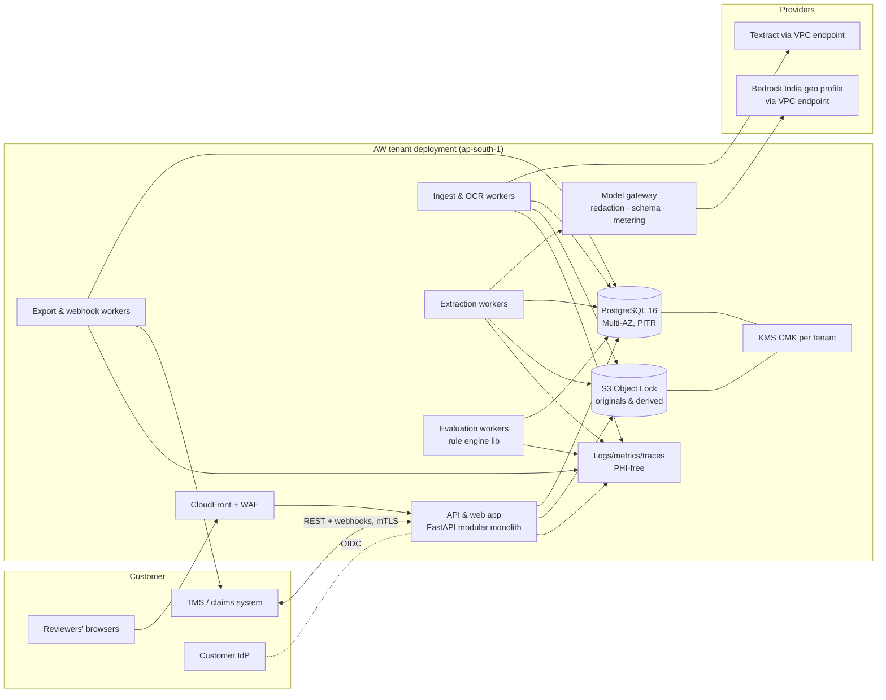
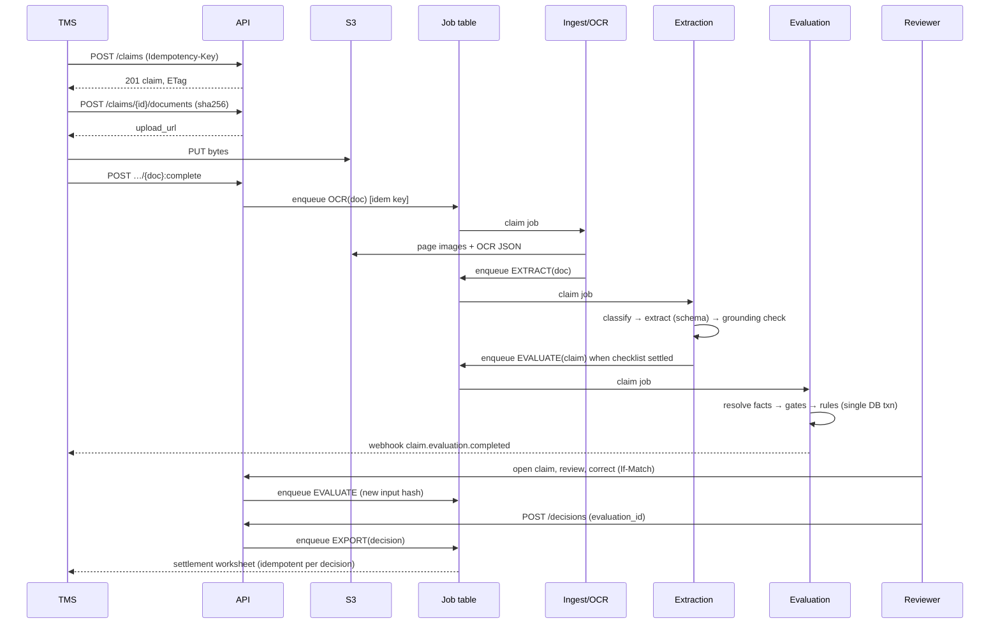

# 04 — System architecture

Status: **PROPOSED**. Superclaims' internal architecture is UNKNOWN. A 2025 job post mentions Python, FastAPI, LangChain and LangGraph (E-LI-08), but a job post does not prove a deployed system. Our choices below are made independently, for a small team running an enterprise pilot in India.

## 1. Constraints that drive the design

1. **Team.** Five to seven engineers plus a claims SME and a part-time medical advisor (11 §4). Operational surface must stay small.
2. **Money must be exact and replayable.** That needs a relational system of record, deterministic computation, and immutable evidence.
3. **India residency by default.** Customer data and model inference stay in Indian regions (NFR-08). The IRDAI 2026 cyber guidelines expect MeitY-empanelled cloud providers, segregation of group or customer environments, and control of sub-outsourcing (E-REG-05).
4. **Latency.** Reimbursement tolerates minutes. Cashless discharge (P1) must leave most of the 3-hour regulatory window for humans (E-REG-01).
5. **Providers fail.** OCR and LLM vendors have outages and rate limits. The system must queue, back off and degrade to manual work rather than produce partial results.

## 2. Decisions

| ID | Decision | Chosen | Alternatives considered | Why | Trade-offs and what would make us revisit |
|---|---|---|---|---|---|
| ADR-01 | Code structure | **Modular monolith** (Python 3.12, FastAPI) with separate worker processes sharing the codebase | Microservices; serverless functions per step | One deployable unit, one schema and one test suite suits five to seven engineers. Module boundaries (claims, documents, extraction, rules, review, config, integration) are enforced by import rules | Scaling is coarse-grained. Revisit when one module needs an independent release cadence or language (e.g. a GPU OCR service) |
| ADR-02 | System of record and queue | **PostgreSQL 16** for all state. Job queue as a table using `SELECT … FOR UPDATE SKIP LOCKED` | Redis/Celery; Kafka; SQS | The job state sits in the same transaction as the domain state, which makes idempotency and crash recovery simple. No second datastore to secure | Throughput ceiling around thousands of jobs per minute, ample for 100k claims a month (~7 jobs per claim). Revisit above ~1M claims a month, or if a TMS needs event streaming |
| ADR-03 | Tenancy | **Single-tenant deployment per pilot customer.** Schema keeps `tenant_id` plus row-level security (validated in `validate_db.sh`) for a later pooled mode | Pooled multi-tenant from day one | Matches the IRDAI segregation expectations (E-REG-05) and insurer procurement norms. Per-tenant KMS keys and buckets. Blast radius is one customer | Higher infrastructure cost per customer (~US$2k/month assumed, 09). Revisit at 10+ small customers |
| ADR-04 | Cloud and region | **AWS ap-south-1 (Mumbai) primary, ap-south-2 (Hyderabad) for disaster recovery** | Azure Central/South India; GCP Mumbai/Delhi | Claude models available with India-only inference via Bedrock's India geographic profile, routing only between ap-south-1 and ap-south-2 (E-PRC-05, COMPANY-REPORTED by AWS). Managed OCR also available | Vendor concentration. Confirm MeitY empanelment and STQC audit status (OQ-40) and Textract availability in ap-south-1 (OQ-41). Revisit if a customer mandates Azure |
| ADR-05 | OCR | **Native text first; managed OCR for scans** (Textract DetectDocumentText plus Tables on bill pages), behind an `OcrProvider` interface. Self-hosted PaddleOCR (Apache-2.0) evaluated as fallback | Self-hosted only; Document AI (India location unconfirmed); Azure Document Intelligence (price page unreadable, E-PRC-07) | Managed OCR avoids GPU operations in the pilot. The interface allows a bake-off on 200 real pages (07 §2, BL-07) | Per-page cost (₹11.71 per claim modelled, 09). Revisit after the bake-off, or if handwriting or regional scripts dominate |
| ADR-06 | LLM access | **Model gateway module** with provider adapters. Default: Bedrock India geo-profile (Haiku-class for classification and extraction; Sonnet-class for cited clinical summaries) | Azure OpenAI in India regions; Gemini on Vertex (India residency unconfirmed); self-hosted open-weights on GPU | Gives residency plus a single place for PHI redaction, prompt versioning, schema enforcement, cost metering and kill-switches | Model availability in the India profile is limited (Opus 5, Sonnet 5, Haiku 4.5 per E-PRC-05). Bedrock India pricing is unconfirmed (OQ-42). Revisit after the extraction bake-off |
| ADR-07 | Rule engine | **In-house deterministic engine** (Python `Decimal`), rule logic in code, parameters in versioned JSON | Drools/DMN; generic JSON rules engines; LLM-as-adjudicator | The rules are few (≈25), deeply financial and order-sensitive. They need remaining-amount semantics and per-line provenance that generic engines express poorly. An LLM adjudicator cannot give reproducible money | Customers cannot write arbitrary new logic without us. Accepted: new rule types go through engineering, while parameters stay customer-owned |
| ADR-08 | Workflow orchestration | **Explicit state machines in Postgres** (03 §2) plus jobs | Temporal; Step Functions | The flows are short and well defined; one less platform to operate | Long-running sagas (TMS round-trips with retries) are hand-written. Revisit if there are more than ~5 external integrations with compensations |
| ADR-09 | Frontend | **React + TypeScript SPA** with PDF.js for the evidence viewer, served from a CDN behind WAF | Server-rendered pages | The evidence-synced three-pane workspace needs client state and fast page rendering | Needs a front-end specialist |
| ADR-10 | Identity | **Customer IdP via OIDC** (Keycloak self-hosted per tenant, or Cognito federation). Roles mapped from IdP groups. API clients use OAuth2 client credentials, with mTLS for TMS links | Local passwords | No password handling; customer controls joiners and leavers | IdP integration effort per customer |
| ADR-11 | Audit | **Append-only, hash-chained `audit_event` table** (DB trigger forbids UPDATE and DELETE). Daily anchoring of chain heads to an S3 Object Lock bucket | Ledger database; blockchain | Tamper-evident with standard tools; verified in tests | Anchoring job must be monitored |
| ADR-12 | Phase 1 build substitutions | The workbench build (`workbench/`) uses Starlette with an OpenAPI-driven contract layer, a stdlib PostgreSQL client (psycopg when installed), a plain-JavaScript UI with server-rendered page images, development tokens, and a local write-once store | FastAPI, psycopg, React/PDF.js, OIDC, S3 Object Lock as in ADR-01/02/04/09/10 | The build sandbox had no package index or cloud account. Data model, contract and engine are unchanged | Replace each substitute before G2; the adapters for psycopg, Bedrock, S3 and OIDC are written but not executed. Full record: `workbench/docs/ADR-12-phase-1-build-substitutions.md` |

## 3. Components

| Component | Responsibility | Depends on | Owns tables |
|---|---|---|---|
| API & web app | Auth, RBAC, claims, documents, review actions, queries, decisions, config UI, read models | PG, S3 (pre-signed URLs), IdP | claim, document, reviewer_action, decision, query_*, config_artifact |
| Ingest/OCR workers | Hash verification, malware scan, page split, text-layer detection, OCR, quality score | S3, OCR provider | document_page, processing_job |
| Extraction workers | Classification, structured extraction, grounding check, normalisation, line candidates | Model gateway, S3 | extraction_run, extracted_fact, bill_line (candidate) |
| Reconcile step (inside evaluation worker) | Fact resolution, conflicts, member matching | — | resolved_fact, finding |
| Evaluation workers | Load resolved facts and effective configs, run the rule engine, persist the evaluation atomically, mark predecessors | Rule engine library | evaluation, rule_execution, adjustment, finding |
| Export/webhook workers | Settlement worksheet (JSON+PDF), TMS export, webhooks with retries and dead-letter | TMS | export_record, webhook_delivery |
| Model gateway | Provider adapters, prompt registry (versioned), PHI minimisation, JSON-schema-constrained output, timeouts, circuit breakers, token/cost metering, kill-switch per tenant | Bedrock (or other) | — (metrics only) |
| Rule engine library | Pure functions: (facts, configs) → evaluation result. No I/O | — | — |

## 4. End-to-end flow (IPD reimbursement)

## 5. Synchronous and asynchronous work; reliability mechanics

- **Synchronous:** all user-facing reads and writes; claim creation; upload slot creation; reviewer actions; decisions. Target p95 under 300 ms excluding the evidence image load.
- **Asynchronous:** OCR, extraction, evaluation, exports, webhooks, configuration replay. Each is one job row. The job's `idempotency_key` combines the subject, the job kind and a pipeline or engine version, so a retry or duplicate enqueue is a no-op (`UNIQUE (tenant_id, job_kind, idempotency_key)`).
- **Timeouts and retries:**

  | Job | Timeout | Retries / backoff | Then |
  |---|---|---|---|
  | OCR call | 60 s per page | 5 attempts, backoff from 30 s to 30 min with jitter | `FAILED_TECHNICAL` |
  | LLM call | 45 s | 3 attempts, then a circuit breaker opens for that provider for 5 min | Claim stays `PROCESSING` with a visible reason; processor may enter facts manually |
  | Evaluation | 30 s | Pure CPU, retried twice | `FAILED` with an engine error code |
  | Webhooks | 10 s | Exponential backoff for 24 h | Dead-letter plus alert |

- **Exactly-once effects from at-least-once execution:**
  - An evaluation is persisted in one transaction (evaluation, rule_executions, adjustments, findings). The unique keys `(claim, input_hash, engine_version)` and `(evaluation, line, rule_execution)` make a crashed-and-retried worker either commit once or fail cleanly (TC-REL-04).
  - Exports are unique per (decision, target).
  - Inbound callbacks are de-duplicated on the sender's event ID plus our `idempotency_key` table (TC-REL-03).
- **Duplicate detection:**
  - Exact duplicate files are caught by hash per claim.
  - Duplicate claims are caught by `external_ref`, plus R-ANOM-DUP-CLAIM for near-duplicates across claims (P1).
  - Duplicate bill lines are caught by R-LINE-DUPLICATE.
- **Recovery:** workers are stateless. Expired locks (`locked_until`) return jobs to the queue. Any claim whose jobs are all terminal but which is still in `PROCESSING` is surfaced to supervisors by a reconciler that runs every 5 minutes.

## 6. Evidence preservation and lineage

- Originals sit in an S3 bucket with **Object Lock (compliance mode)**, retention set per tenant policy (08 §5). Keys are `tenant/claim/document/sha256`. They are never overwritten. A corrected document is a new object with `supersedes_document_id`.
- Derived artefacts (page images, OCR JSON, extraction JSON) are versioned by pipeline version. They can be regenerated and are deletable before originals are.
- The lineage chain behind every adjustment: `adjustment → rule_execution → evaluation (config_versions, input_hash) → resolved_fact → extracted_fact (evidence: document, page, bbox, quote; extraction_run: model_ref, prompt_version) → document (sha256, object_key)`. The UI's evidence chip walks this chain.
- Each adjustment also carries its **authority** (`artifact@version`, document, clause) from the published configuration, so the money trail reaches the wording or hospital agreement as well as the claim documents. If a reviewer overrode it, `origin`, `engine_amount` and `override_ref` link to the reviewer action (06 §2).
- `input_hash` covers the engine input and every config version, so a configuration change can never be mistaken for an identical re-run (TC-CFG-04).

## 7. Configuration, versioning, permissions, isolation

- Configuration artifacts are immutable once published (05 §1). Evaluations pin exact versions. Replay runs against golden claims before publishing (CAP-21).
- RBAC is enforced in the API layer from IdP claims (03 §4). Row-level security is defence in depth.
- Isolation:
  - per tenant: VPC, database, bucket, KMS key, IdP realm and model-gateway quota;
  - the support team gets no standing access; break-glass access is time-bound, approved by the customer and audited (08 §2).

## 8. Observability and operations

- **Logs:** structured JSON with correlation ID, tenant ID, claim ID and job ID. **Never** document text, names, diagnoses or prompts. Error payloads carry codes, not content (enforced by a log filter plus a unit test, TC-SEC-04).
- **Metrics:**
  - per job kind: latency, failure rate, queue depth, age of the oldest job;
  - per provider: error rate, tokens, cost;
  - business: TAT compliance, blocked share, recommendation-vs-decision agreement (10 §2).
- **Traces:** OpenTelemetry spans for requests and jobs. No PHI attributes.
- **Audit vs ops logs:** audit events are domain records kept for the retention period; ops logs are operational and kept for 180 days or more, aligned with CERT-In expectations (verify, OQ-43).
- **Alerting:** queue age > 15 min; provider circuit open; TAT breach risk; webhook dead-letters; audit chain anchoring failure; RLS policy drift (CI check).
- **SLOs (pilot):** availability 99.5% in business hours; evaluation p95 ≤ 15 min for reimbursement.

## 9. Backups, restore and disaster recovery

- PostgreSQL: automated snapshots plus point-in-time recovery (RPO ≤ 15 min), with cross-region snapshot copies to ap-south-2.
- S3: versioning plus Object Lock, with replication to ap-south-2.
- Restore drills: quarterly. Restore into an isolated account, then verify the audit chains and recompute a sample of evaluation output hashes (they must match). This is evidence for the pilot gate (10 §6).
- RTO ≤ 4 h (pilot). Runbooks are in 08 §7.

## 10. Failure modes

| Failure | Detection | System behaviour | Recovery | Test |
|---|---|---|---|---|
| OCR provider outage | Error rate and circuit breaker | Jobs back off; documents stay `EXTRACTING`; banner "OCR delayed" | Auto-resume; manual fact entry possible | TC-REL-01 |
| LLM outage or timeouts | Circuit breaker | No extraction or summaries; rules still run on facts entered manually; claim marked "AI unavailable" | Auto-resume | TC-REL-02 |
| LLM returns invalid or ungrounded output | Schema validation; grounding check | Fact rejected (`NOT_FOUND`); field → NEEDS_REVIEW | Reviewer entry | TC-EXT-02 |
| Prompt injection in a document | Output schema plus instruction-pattern detector | No behaviour change possible (no tools, schema-only output); `EMBEDDED_INSTRUCTIONS_IGNORED` warning | — | TC-SEC-03 |
| Worker crash mid-evaluation | Lock expiry | Transaction rolled back; job retried; unique keys prevent duplicates | Auto | TC-REL-04 |
| Duplicate TMS callbacks | Idempotency table | Same response replayed | — | TC-REL-03 |
| Config published with an error | Replay diff; four-eyes | Not effective until approved; a retroactive change is opt-in | New version; affected evaluations marked stale | TC-CFG-01..02 |
| Late document after decision | Document on a FINALISED claim | Claim → REOPENED (supervisor); new evaluation; delta decision | — | TC-RPR-01 |
| Database failover | RDS event | API returns 503 with retry-after; jobs resume | Automatic (Multi-AZ) | DR drill |
| Region outage | Health checks | Read-only notice | Restore in ap-south-2 (RTO 4 h) | DR drill |

## 11. Deployment topology (pilot)

- One AWS account per tenant (an AWS Organizations OU).
- VPC with private subnets. ECS Fargate services: `api`, `worker-ingest`, `worker-extract`, `worker-eval`, `worker-export`.
- RDS PostgreSQL 16 Multi-AZ. S3 buckets: originals (Object Lock), derived, audit anchors.
- KMS customer-managed key. Secrets Manager.
- VPC endpoints for S3, Textract, Bedrock, KMS and Secrets. No NAT egress except to allow-listed TMS endpoints.
- CloudFront + WAF for the SPA and API.
- Infrastructure as code: Terraform. CI/CD: GitHub Actions running tests, contract validation (`verification/*`) and the property tests on every change. Staged deploys (staging tenant → pilot tenant) with database migrations gated by `validate_db.sh`-style checks.

## 12. What would invalidate this architecture

| Assumption | What breaks if it is false | Cheapest test |
|---|---|---|
| Bedrock India profile gives adequate extraction quality at acceptable cost | ADR-06 needs a different provider or self-hosted models (GPU operations, team skills) | 200-page bake-off (BL-07) |
| Managed OCR handles Indian hospital bills (stamps, carbon copies, regional text) | Self-hosted or vendor OCR plus more manual entry | Same bake-off, with a stratified sample |
| The customer accepts single-tenant AWS in India | A pilot on Azure or on-premises → re-platforming | Ask in the first security review (OQ-40) |
| A TMS can call an API and accept webhooks | Need file drops or RPA, i.e. a new integration component | Integration questionnaire (OQ-50) |
| A Postgres job queue suffices | Move to SQS | Load test at 3× expected peak (BL-31) |
| Cashless discharge needs evaluation in ≤ 20 min | If customers need ≤ 2 min, extraction must be streaming or partial and the evaluation incremental | Measure the bill-to-evaluation latency distribution in the pilot |
