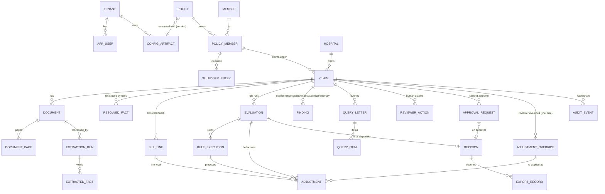

# 05 — Data model and API contracts

Status: **PROPOSED**. **No Superclaims endpoints, payloads or schemas were observed.** The company publishes no API documentation, and its marketing domain exposes no API (E008). Every endpoint below is our design.

Machine-readable sources of truth:

- `db/schema.sql`: PostgreSQL 16 DDL, 31 tables, row-level security on every tenant table.
- `api/openapi.yaml`: OpenAPI 3.1, 33 paths and 36 operations (including `GET /me`, which returns the caller's roles and approval limit).
- `schemas/*.schema.json`: JSON Schema 2020-12, eleven schemas:
  - engine input and evaluation result;
  - extraction output;
  - configuration artifacts: policy config, NME list, tariff, checklist, tenant workflow config, and the classifier map (document-type keywords, bill-line categories, room categories and procedure synonyms used by the extraction and categorisation steps);
  - settlement worksheet;
  - audit event (38 event types).

These were executed and checked:

- `verification/validate_db.sh` applied the DDL to a fresh PostgreSQL 16 instance and loaded the trace outputs (1, 2, 3a→3b) and two decisions (DEC-0001 by PROC-07 alone; DEC-0002 by PROC-11 with SUP-02's second approval). It reconciled billed = payable + adjustments in SQL and confirmed every adjustment carries clause authority. It ran 11 negative constraint tests and an RLS isolation test (0 rows visible to another tenant). All passed.
- `verification/validate_contracts.py` checked schema validity, every fixture and config against its schema, OpenAPI `$ref` resolution, request examples against their schemas, and enum parity across DDL, API and schemas. 53 checks passed.
- `verification/mutation_test_contracts.py` fed the validator 8 deliberately broken inputs (float money, a repudiation without CRC reference, a TPA repudiation communicated by the TPA, an adjustment without authority, and others). It rejected all 8.
- The Phase 1 workbench (`workbench/`) implements this contract. Its API layer loads `api/openapi.yaml` at start-up, enforces the required headers declared there, and validates every request body against the declared schema. Its tests check responses against `evaluation-result.schema.json` and `settlement-worksheet.schema.json`.

## 1. Data model

### 1.1 Entity map



Clinical flags and anomaly flags are `finding` rows with `category = CLINICAL` or `ANOMALY`. Both must carry an `uncertainty_note`, which a DB check enforces. Keeping them in one table gives one lifecycle (OPEN → RESOLVED/DISMISSED/SUPERSEDED) and one place for evidence.

### 1.2 Key field definitions

| Entity.field | Type | Constraint / meaning |
|---|---|---|
| `*.tenant_id` | text | Present on every tenant-owned row. RLS policy `tenant_id = current_setting('app.tenant_id')` |
| `claim.workflow` | enum `workflow_type` | PREAUTH, ENHANCEMENT, CASHLESS_DISCHARGE, IPD_REIMBURSEMENT, OPD_REIMBURSEMENT, OPD_CASHLESS |
| `claim.status` | enum `claim_status` | State machine in 03 §2.2. `row_version` is used for optimistic concurrency (ETag) |
| `claim.admission_date` | date | The *established* value. NULL while a date conflict is open. Candidates live in `extracted_fact` |
| `claim.intimated_at` | timestamptz | Date of intimation. Interest on late reimbursement accrues from here (E-REG-03) |
| `claim.submitted_at` | timestamptz | First submission of the claim. Start of the 15-day reimbursement clock, even if documents are still missing (whether queries pause it: OQ-21) |
| `claim.investigation_hold` | boolean | Set by FWA_ANALYST or SUPERVISOR. Blocks decisions until released; audited |
| `document.sha256` | text | Unique per claim. Duplicate uploads are idempotent |
| `document.object_key` | text | Write-once object. Never mutated |
| `document.supersedes_document_id` | text | Lineage for corrected or replacement documents |
| `extracted_fact.evidence` | jsonb | `{document_id, page, bbox[4], quote}` |
| `extracted_fact.grounding_check` | enum | `VERIFIED` (quote found in the page text layer), `NOT_FOUND` (fact unusable), `NOT_APPLICABLE` |
| `resolved_fact.basis` | enum | AUTO_AGREEMENT, AUTO_SINGLE_SOURCE, REVIEWER_SELECTED, REVIEWER_ENTERED, UNRESOLVED. One active row per (claim, field) via a partial unique index |
| `bill_line.billed_paise` | bigint | ≥ 0. `bill_version` increments when a new bill supersedes an old one |
| `bill_line.category_source` | enum | DICTIONARY, MODEL, REVIEWER |
| `evaluation.config_versions` | jsonb | Exact `artifact@version` for policy config, NME list, tariff and checklist, plus engine and rule versions |
| `evaluation.input_hash` | text | SHA-256 of the canonicalised engine input **and** `config_versions`. Unique with `engine_version` per claim: an identical re-run is a no-op, while any new config version produces a new evaluation (TC-CFG-04) |
| `evaluation.recommended_payable_paise` | bigint | NOT NULL when COMPUTED. NULL when BLOCKED (checks) |
| `adjustment.amount_paise` | bigint | Positive reduces the payable. Negative only for `ROUNDING`. Must be ≤ `base_before_paise` |
| `adjustment.engine_amount_paise` | bigint | What the engine computed. Differs from `amount_paise` only when `origin = REVIEWER_OVERRIDE` |
| `adjustment.origin` / `override_ref` | enum / text | ENGINE or REVIEWER_OVERRIDE. An override row must reference its reviewer action (check) |
| `adjustment.authority` | jsonb NOT NULL | `{artifact, doc_id, clause}`: the configuration artifact@version and the wording or agreement clause that authorises the deduction. DB check requires all three keys |
| `adjustment.evidence` | jsonb | Non-empty (check). Each item is a document reference `{document_id, page, bbox, quote}` or a record reference `{record_type, record_id, field}` (e.g. the SI ledger for the SI cap, the member's age for co-pay) |
| `adjustment.formula` / `explanation` | text | Human-readable. The explanation names the clause |
| `adjustment_override.line_fingerprint` | text | SHA-256 over the line's description, category, billed amount, quantity, unit rate, ward context, invoice number and service date. The override is re-applied only while the fingerprint matches (TC-REV-03) |
| `finding.category` / `uncertainty_note` | enum / text | IDENTITY, DOCUMENT, FINANCIAL, ELIGIBILITY, CLINICAL, ANOMALY. CLINICAL and ANOMALY require a note (check) |
| `finding.blocked_scopes` | text[] | ALL_FINANCIAL (no line or claim rule, no payable; eligibility still runs on identity-matched documents), LINE_RULES, ROOM_DAYS, WAITING_PERIOD, PRE_POST_WINDOW |
| `approval_request` | table | Proposed decision awaiting a second approver: requester, approver, rule that fired, status (PENDING, APPROVED, RETURNED). Approver ≠ requester (check) |
| `decision.disposition` | enum | APPROVED_FULL, APPROVED_PARTIAL, REPUDIATED_WITH_CRC_APPROVAL, WITHDRAWN, CLOSED_DUPLICATE. A query is a workflow step, not a disposition |
| `decision.crc_reference` / `communicated_by` | text / enum | Repudiation requires a CRC reference and `communicated_by = INSURER` (check; E-REG-04) |
| `decision.duplicate_of_claim_id` | text | Required for CLOSED_DUPLICATE |
| `audit_event.prev_hash`, `event_hash` | text | Hash chain per claim. UPDATE and DELETE are forbidden by trigger |

### 1.3 Money and dates

- Money is stored as integer paise (`BIGINT`). APIs use decimal strings with exactly two places. Floats are rejected (schema regex). Totals are never stored redundantly except `billed_total_paise` and `recommended_payable_paise` on the evaluation, both of which are recomputable and checked by SQL reconciliation.
- Policy and clinical dates are `DATE`, with no time zone, because a hospital's "admitted 02/09/2026" is a civil date. Times of admission (needed for some day-count rules) are a separate optional fact. System times are `TIMESTAMPTZ`, stored in UTC and displayed in IST.
- Day counting for room days follows the configured convention (`room_day_count`: calendar days vs midnights; MIDNIGHTS in the illustrative config). R-LINE-ROOM-CAP compares billed room days with this count (OQ-25 for the customer's real convention).

### 1.4 Sum-insured utilisation ledger

Available sum insured is derived from `si_ledger_entry` rows (OPENING_PAID_EXTERNAL, RESERVED, RELEASED, PAID) and is never stored as a mutable balance. That keeps two concurrent claims on one member from both consuming the same balance:

- an evaluation reads the available amount and records it;
- a decision **reserves** the approved amount in the same transaction as the decision (`SELECT … FOR UPDATE` on the policy-member row);
- if the reservation would make the available amount negative, the decision fails with 409 and the claim re-evaluates.

Prior utilisation recorded in the TMS arrives as OPENING_PAID_EXTERNAL entries (OQ-26: does the TMS expose it in real time?).

### 1.5 Retention considerations

| Data class | Examples | Proposed default | Basis |
|---|---|---|---|
| Original claim documents | PDFs, images | Retained per customer contract; default 10 years after claim closure (placeholder) | TPA must keep records "for such period as may be specified" (E-REG-04 Reg 19(2)). Actual period needs legal advice (OQ-27) |
| Derived artefacts | OCR JSON, page images | Deletable and regenerable; default 2 years | Minimisation (DPDP, E-REG-10) |
| Facts, evaluations, adjustments, decisions, audit events | DB rows | Same as originals | Needed to explain decisions (grievance, ombudsman) |
| Model prompts and outputs containing PHI | Gateway request/response | Not retained by default. A sampled 1% kept encrypted for 90 days for evaluation, with customer consent | Minimisation. AWS states Bedrock does not store model inputs or outputs by default (E-PRC-05, COMPANY-REPORTED); confirm in the service terms and DPA |
| Ops logs | No PHI by design | ≥ 180 days | Verify CERT-In requirement (OQ-43) |

Deletion uses cryptographic erasure of tenant keys at contract end, with a certificate of destruction (E-REG-05 asks this of cloud providers).

### 1.6 From extraction output to engine input

The engine never reads model output directly. It reads `schemas/engine-input.schema.json`, assembled from **resolved** facts and **confirmed** bill lines. Each value keeps its evidence.

| Engine input field | Built from (extraction path or record) | Rule |
|---|---|---|
| `member`, `policy` | Policy and member import (`/imports/policies`), SI ledger | Never from documents |
| `identity_observations[]` | `patient.name`, `patient.gender`, `patient.age_years` on each document | One observation per document, with its source and evidence |
| `admission_date_observations[]` | `admission.date` (+ `admission.time`) on each document | Candidate dates; `admission_date` is set only when they agree or a reviewer resolves them |
| `admission_date`, `discharge_date` | `resolved_fact` for `admission.date`, `discharge.date` | NULL while a conflict is open |
| `itemised_bill_available`, `bill_stated_total`, `bill_no` | `bill.is_itemised`, `bill.total` (net of `bill.discount`, `bill.advance_paid`), `bill.number` | Feeds R-GATE-ITEMISATION and R-ANOM-BILLNO-REUSE |
| `bill_lines[]` | `line_items[]` after categorisation and reviewer confirmation | `category` from dictionary, model or reviewer (`category_source`); `ward_context` from dates and labels |
| `procedure_codes`, `diagnosis` | `procedure.text`, `diagnosis.primary_text`, `diagnosis.icd10_as_written` mapped by the customer's procedure dictionary | Codes are never inferred by a model |
| `ped_signals[]` | `history.past_illness_text`, `history.duration_text` | Signals only; the medical officer decides |
| `documents_present[]` | Document classification | Feeds R-DOC-COMPLETENESS |
| `portfolio_bill_number_index[]` | Other claims at the same hospital | Feeds R-ANOM-BILLNO-REUSE |
| `reviewer_overrides[]` | `adjustment_override` rows | Re-applied only while the line fingerprint matches |

Facts whose quote fails the grounding check (`NOT_FOUND`) are excluded at this step.

## 2. API (PROPOSED)

Full contract: `api/openapi.yaml`.

| Operation | Method & path | Used by | Notes |
|---|---|---|---|
| createClaim | `POST /v1/claims` | TMS adapter, portal | Idempotency-Key; 409 on duplicate `external_ref` |
| listClaims | `GET /v1/claims` | Queue S-01 | Cursor pagination; filters on status, workflow, assignee, SLA |
| getClaim | `GET /v1/claims/{claim_id}` | S-02 | ETag |
| createDocumentUpload | `POST /v1/claims/{id}/documents` | TMS, portal | Pre-signed PUT URL; a duplicate hash returns the existing record |
| completeDocumentUpload | `POST /v1/claims/{id}/documents/{doc}:complete` | TMS, portal | Verifies hash; queues processing (202) |
| listDocuments | `GET /v1/claims/{id}/documents` | S-02 | Status per document |
| requestEvaluation | `POST /v1/claims/{id}/evaluations` | S-02 (re-run), config replay | 202; webhook on completion |
| getCurrentEvaluation | `GET /v1/claims/{id}/evaluations/current` | S-02, S-04, S-05 | Returns `evaluation-result.schema.json` |
| recordReviewerAction | `POST /v1/claims/{id}/reviewer-actions` | S-03..S-05 | If-Match; comment required for overrides and dismissals. Action types match the DB enum (C7 parity), including reclassify document, mark page unreadable, acknowledge finding, place or release investigation hold, and `RECORD_CRC_DECLINED` (a CRC approval is recorded as a decision instead) |
| draftQuery / approveQuery | `POST /v1/claims/{id}/queries`, `POST /v1/queries/{qid}:approve` | S-06 | Only approved queries are released |
| recordDecision | `POST /v1/claims/{id}/decisions` | S-07 | Within the user's limit and no second-approval rule fired. 409 if the evaluation is stale; CRC reference and `communicated_by = INSURER` for repudiation; duplicate claim ID for CLOSED_DUPLICATE |
| requestApproval / approveRequest / returnRequest | `POST /v1/claims/{id}/approval-requests`, `POST /v1/approval-requests/{arid}:approve`, `…:return` | S-07 | Second approval. The response names the workflow-config rule that fired. Approving writes the decision |
| assignClaim / withdrawClaim / reopenClaim | `POST /v1/claims/{id}:assign`, `:withdraw`, `:reopen` | S-01, supervisor | Reopen is SUPERVISOR-only and creates a new evaluation |
| listFacts / listBillLines / getPage | `GET /v1/claims/{id}/facts`, `/bill-lines`, `/documents/{doc}/pages/{n}` | S-03, S-04 | Facts with candidate observations and grounding status; page image URL, text layer and word boxes |
| listFindings | `GET /v1/claims/{id}/findings` | S-05 | Lifecycle across evaluations; resolve or dismiss via reviewer actions |
| getEvaluation / diffEvaluations | `GET /v1/claims/{id}/evaluations/{eid}`, `…/{eid}/diff` | S-02 "What changed" | History including STALE and SUPERSEDED |
| getWorksheet / listExports | `GET /v1/claims/{id}/decisions/{did}/worksheet`, `GET /v1/claims/{id}/exports` | S-07, TMS | Worksheet per `schemas/settlement-worksheet.schema.json` |
| Config artifacts | `GET/POST /v1/config-artifacts`, `…/versions/{v}:validate`, `:replay`, `:publish` | S-09 | Publisher ≠ author; replay returns per-claim payable changes |
| Imports | `POST /v1/imports/policies`, `POST /v1/imports/si-ledger` | Onboarding, TMS | Policies, members, continuous-cover dates, opening SI utilisation |
| receiveTmsEvent | `POST /v1/integrations/tms/events` | TMS | De-duplicated on the sender's event ID |
| listAuditEvents | `GET /v1/claims/{id}/audit-events` | S-08 | Hash-chained. Event types: `schemas/audit-event.schema.json` |
| Webhooks | `claim.evaluation.completed`, `claim.decision.recorded`, `claim.query.approved` | TMS | At-least-once; de-duplicate on `event_id`; signed (HMAC-SHA256 header, proposed) |

**Cross-cutting behaviour:**

- **Authentication:** OAuth2 client credentials (systems, mTLS recommended); OIDC bearer tokens (users).
- **Errors:** RFC 9457 problem details with a JSON-pointer error list.
- **Pagination:** opaque cursor, `limit` ≤ 200.
- **Concurrency:** `If-Match` on state changes; 412 when stale.
- **Idempotency:** keys retained 24 h; same key + same body → original response; same key + different body → 409.
- **Rate limits:** per client, 429 with `Retry-After`.
- **Versioning:** major version in the path. Additive changes need no version bump. Removals get Deprecation and Sunset headers with ≥ 180 days' notice. Clients must ignore unknown fields and treat unknown enum values as OTHER.
- **Callbacks into AW:** inbound TMS events (document added, claim withdrawn, payment confirmed) go to `POST /v1/integrations/tms/events`. The envelope is in the OpenAPI file; per-TMS payload mapping is specified in BL-20. Events are de-duplicated on the sender event ID.

**Audit event types** (38, in `schemas/audit-event.schema.json`): claim lifecycle (CLAIM_CREATED, _ASSIGNED, _WITHDRAWN, _REOPENED); documents (DOCUMENT_RECEIVED, _QUARANTINED, _CLASSIFIED, _SUPERSEDED; EXTRACTION_COMPLETED, _FAILED); evaluation (RULE_RUN_STARTED, RULE_EXECUTED, RECOMMENDATION_CREATED, RECOMMENDATION_MARKED_STALE, EVALUATION_FAILED); review (REVIEWER_VIEWED_RECOMMENDATION, REVIEWER_ACTION_RECORDED, REVIEWER_CONFIRMED_FINDING, MEDICAL_REVIEW_OPENED, _PENDING, _COMPLETED, ANOMALY_TRIAGED, INVESTIGATION_HOLD_PLACED, _RELEASED); queries (QUERY_DRAFTED, _APPROVED, _SENT, _ANSWERED); decisions (APPROVAL_REQUESTED, _GRANTED, _RETURNED, DECISION_RECORDED, CRC_OUTCOME_RECORDED); exports (SETTLEMENT_WORKSHEET_EXPORTED, EXPORT_ACKNOWLEDGED, EXPORT_FAILED); administration (CONFIG_PUBLISHED, BREAK_GLASS_ACCESS). Actors are `SYSTEM`, `USER:<id>` or `INTEGRATION:<name>`.

### 2.1 Example payloads (synthetic, trace 2)

Create claim:
```json
{"external_ref":"TMS-2026-0002","workflow":"IPD_REIMBURSEMENT","policy_no":"ILL-POL-000202","member_id":"MEM-DEMO-2002",
 "hospital_id":"HOSP-ILL-NW-01","admission_date":"2026-07-01","discharge_date":"2026-07-05","claimed_amount":"172455.75"}
```

Current evaluation (abridged from `fixtures/claims/trace-2-interacting-adjustments.output.json`):
```json
{"claim_id":"CLM-DEMO-0002","evaluation_id":"EVAL-0002-v1",
 "config_versions":{"policy_config":"POLCFG-ILL-INDEMNITY-A@2026.1.0","nme_list":"NMELIST-ILL-A@2026.1.0","tariff":"TARIFF-ILL-HOSP-NW-01@2026.07","checklist":"CHECKLIST-IPD-REIMB@2026.1.0","engine":"ref-harness-0.4.0","rules":{"…":"…"}},
 "recommendation":{"type":"PAY_PARTIAL","computed":true,"recommended_payable":"85000.00","billed_total":"172455.75",
   "line_level_deductions":"71570.00","claim_level_deductions":"15885.75","admissible_after_line_rules":"100885.75",
   "blocked_scopes":[],"human_decision_required":true},
 "adjustments":[{"adjustment_id":"ADJ-0014","level":"LINE","line_id":"L05","rule_id":"R-LINE-TARIFF","rule_version":"1.0.0",
   "reason_code":"TARIFF_EXCESS","amount":"10000.00","base_before":"45000.00","remaining_after":"35000.00",
   "formula":"remaining 45000.00 - tariff 35000.00 x qty 1","explanation":"Billed above agreed tariff item TI-SURG-LAPCHOLE …",
   "origin":"ENGINE","engine_amount":"10000.00",
   "authority":{"artifact":"TARIFF-ILL-HOSP-NW-01@2026.07","doc_id":"ILL-AGREEMENT-NW-01-2026","clause":"Schedule 2 Item rates"},
   "evidence_refs":[{"document_id":"DOC-0002-FB","page":2,"bbox":[40,184,560,198],"quote":"Surgeon fee - laparoscopic cholecystectomy 45,000.00"}]}]}
```

Reviewer override (requires a comment). This is RA-0207 from trace 2b: the CT tariff deduction on L14 is set to ₹0.00. The engine stores it as an `adjustment_override` with the line's fingerprint:
```json
{"action":"OVERRIDE_ADJUSTMENT","evaluation_id":"EVAL-0002-v1","target":{"type":"adjustment","id":"ADJ-0015"},
 "after_value":{"amount":"0.00"},"reason_code":"TARIFF_ITEM_NOT_APPLICABLE",
 "comment":"CT was done as an emergency at an outside centre; tariff item does not apply."}
```

Decision within the user's own limit (trace 1, PROC-07):
```json
{"evaluation_id":"EVAL-0001-v1","disposition":"APPROVED_PARTIAL","approved_payable":"107591.00"}
```

Second approval (trace 2: deductions over 30% of billed). PROC-11 requests, SUP-02 approves, and the approval writes DEC-0002:
```json
{"evaluation_id":"EVAL-0002-v1","proposed_disposition":"APPROVED_PARTIAL","proposed_payable":"85000.00","approver_user_id":"SUP-02"}
```

Error (stale evaluation):
```json
{"type":"https://example.invalid/problems/evaluation-stale","title":"Evaluation is stale","status":409,
 "detail":"New document DOC-0003-FB2 arrived after EVAL-0003-v1; open the current evaluation.","instance":"/v1/claims/CLM-DEMO-0003/decisions"}
```

## 3. Integration patterns

| Pattern | When | Contract | Failure behaviour |
|---|---|---|---|
| API push (TMS calls AW) + webhooks | TMS can make outbound calls | §2 | Retries by TMS with the same Idempotency-Key; our webhooks retry for 24 h, then dead-letter |
| Pull/poll (AW calls the TMS API) | TMS exposes an API but not outbound webhooks | Per-TMS adapter (BL-20) | Cursor-based polling with a watermark; idempotent upserts by `external_ref` |
| Secure portal (no integration) | Early pilot | Upload and download in the AW UI | Manual reconciliation report daily |
| SFTP batch | Legacy TMS | CSV/JSON manifest + PDFs, checksums | Manifest validation; rejected-file report |
| NHCX adapter (P2) | Insurer/TPA live on NHCX (E-REG-08, E-REG-11) | FHIR-based claim bundles through the exchange. Specific profiles to be confirmed against current NHA specifications (OQ-51) | Per NHCX protocol (unverified here) |

Competitor parity: Superclaims names "API", "TMS integration" and "secure portal" (E001). The patterns above cover those three plus SFTP and NHCX.

## 4. Terminology cross-check (single vocabulary across the pack)

| Concept | DB | API / schema | UI | Rules / engine | Tests |
|---|---|---|---|---|---|
| Workflow | `workflow_type` | `Workflow` | Queue filter | `claim.workflow` | C7 parity |
| Claim status | `claim_status` | `ClaimStatus` | Queue, header | — | C7 parity |
| Document status | `doc_status` | `Document.status` | Documents pane | — | C7 parity |
| Recommendation | `recommendation_type` | `recommendation.type` | Recommendation chip | `_recommendation_type()` | C7 parity, FI-08 |
| Disposition | `disposition_type` | `DecisionCreate.disposition` | Decision drawer | — | C7 parity, TC-DEC-01 |
| Blocked scope | `finding.blocked_scopes` | `finding.blocked_scopes` | BlockBanner | `blocked_scopes` | FI-07 |
| Adjustment | `adjustment` | `adjustments[]` | DeductionChip | `adjust_line`/`adjust_claim` | FI-01..06 |
| Authority (clause) | `adjustment.authority` | `adjustments[].authority` | Clause line in the evidence pane | `Run.authority()` | TC-EVD-01, TC-CFG-03 |
| Reviewer override | `adjustment_override`, `adjustment.origin` | `reviewer_overrides[]`, `origin` | DeductionChip "reviewer-override" | `adjust_line` override branch | TC-REV-03 |
| Reviewer action type | `reviewer_action_type` | `ReviewerAction.action` | S-03..S-07 actions | — | C7 parity |
| Evidence | `extracted_fact.evidence`, `adjustment.evidence` | `evidence_refs[]` | EvidenceChip | `evidence` | TC-UX-02 |

C7 is the automated parity check in `validate_contracts.py`. It runs and passes.
